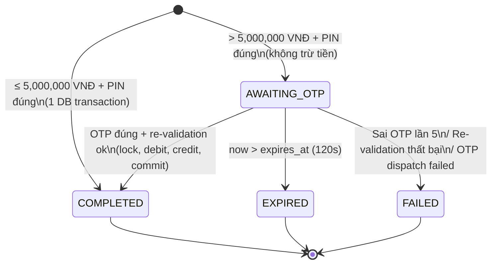
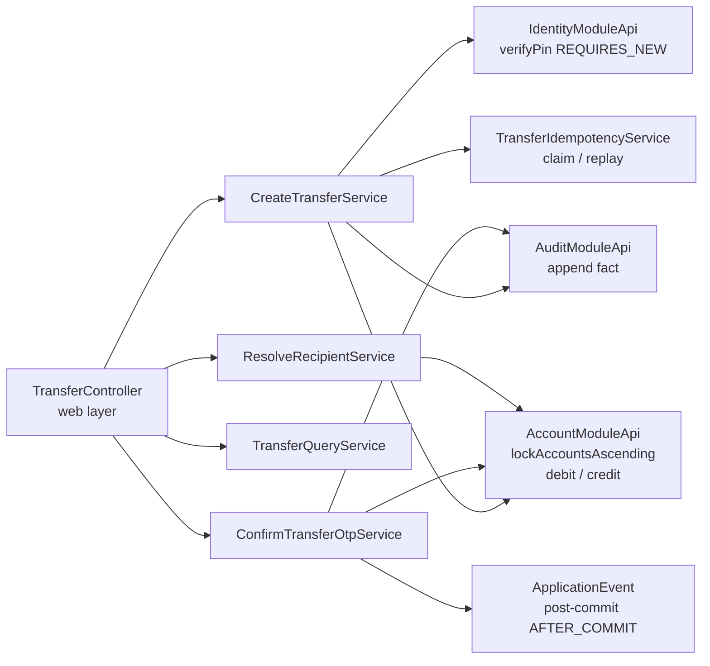

# 0. Introduction — Module Transactions

## 1. Bối cảnh dự án

**Digital Banking Simulator** là hệ thống mô phỏng nghiệp vụ ngân hàng số theo định hướng production, phục vụ mục tiêu học Cloud Application Development. Hệ thống không xử lý tiền thật và không kết nối payment gateway hoặc core banking thật.

Stack tổng thể:
- **Backend:** Spring Boot 3.3.x, Java 21, Maven — triển khai dưới dạng Modular Monolith.
- **Database:** PostgreSQL (ACID, row-level locking, `NUMERIC(19,0)` cho tiền).
- **Frontend:** React + Vite + Zustand, giao tiếp qua REST/OpenAPI.
- **Infrastructure:** Docker Compose (local), Cloud container runtime (production).

---

## 2. Vai trò của Module Transfer

Module `transfer` chịu trách nhiệm toàn bộ vòng đời của một lệnh chuyển tiền nội bộ:

| Trách nhiệm | Chi tiết |
|---|---|
| **Recipient resolution** | Tra cứu người nhận qua số tài khoản, trả về thông tin masked |
| **Transfer orchestration** | Xác thực PIN, tạo lệnh, quản lý idempotency key |
| **Small transfer (≤ 5M VNĐ)** | Lock → debit/credit → commit trong một DB transaction |
| **Large transfer (> 5M VNĐ)** | Tạo `AWAITING_OTP`, dispatch OTP, step-up confirm |
| **State machine** | Quản lý trạng thái `AWAITING_OTP → COMPLETED / EXPIRED / FAILED` |
| **History & query** | Phân trang ổn định theo cursor, visibility rule theo ownership |
| **Idempotency** | Replay-safe retry với SHA-256 payload hash |
| **Risk trigger** | Phát sự kiện sau commit để module `risk` đánh giá sau commit |
| **Audit** | Ghi audit fact trong cùng transaction với money mutation |

Module `transfer` **không** sở hữu:
- Bảng `accounts`, `otp_challenges`, `audit_events`, `risk_flags` — chỉ giao tiếp qua module API.
- Logic PIN check — gọi sang `identity` module qua `IdentityModuleApi.verifyPin()` trong REQUIRES_NEW transaction.

---

## 3. Phạm vi (Scope)

### Thuộc phạm vi module transfer

```text
transfer/api/TransferModuleApi.java
transfer/application/ResolveRecipientService.java
transfer/application/CreateTransferService.java
transfer/application/ConfirmTransferOtpService.java
transfer/application/TransferQueryService.java
transfer/application/TransferExpirationPolicy.java
transfer/domain/Transfer.java
transfer/domain/TransferStatus.java
transfer/domain/TransferPolicy.java
transfer/domain/TransferLockOrder.java
transfer/infrastructure/persistence/TransferEntity.java
transfer/infrastructure/persistence/TransferRepository.java
transfer/infrastructure/persistence/TransferLockRepository.java
transfer/infrastructure/persistence/TransferIdempotencyService.java
transfer/web/RecipientController.java
transfer/web/TransferController.java
```

### Giao tiếp qua module API (không được inject repository của module khác)

```java
// Module APIs được consume
AccountModuleApi   // lock accounts, debit/credit, validate eligibility
IdentityModuleApi  // verifyPin (REQUIRES_NEW), consumeOtp, issueOtp
AuditModuleApi     // append audit fact trong cùng transaction

// Module API mà transfer publish sang
TransferModuleApi  // public API của chính module này
```

### Ngoài phạm vi

- `identity/**`, `account/**`, `audit/**`, `risk/**` — proposal nếu cần thay đổi.
- Frontend, load test, CI pipeline — không thuộc BE-3.
- Migration đã apply — chỉ thêm forward migration.

---

## 4. Nguyên tắc thiết kế cốt lõi

### 4.1 Financial Consistency

> **Quy tắc vàng:** Debit và credit phải commit trong **một** DB transaction duy nhất. Không có trạng thái nào mà tiền đã trừ mà chưa cộng.

- `BigDecimal` + SQL `NUMERIC(19,0)` — không bao giờ dùng `float`/`double`.
- Amount phải là số nguyên dương, không có phần thập phân, trong range `[2000, 10000000]`.
- Non-negative balance constraint ở cả DB và application layer.

### 4.2 Idempotency

- Client sinh `Idempotency-Key` một lần khi user xác nhận.
- Canonical payload hash = SHA-256 của `{sourceAccountId, destinationAccountId, amount, currency, memo}` — **không bao gồm `pin`**.
- Same key + same hash → replay result gốc, không tạo transfer mới.
- Same key + khác hash → `409 IDEMPOTENCY_KEY_REUSED`.
- Concurrent duplicate → DB unique index `(actor_id, operation, idempotency_key)` đảm bảo chỉ một resource được tạo.

### 4.3 Deadlock Prevention (Sorted Resource Locking)

Khi cần lock 2 account rows, luôn lock theo thứ tự **UUID ASC do PostgreSQL quyết định**, không theo Java UUID natural comparison:

```sql
SELECT id, customer_id, balance, currency, status
FROM accounts
WHERE id IN (:account_a, :account_b)
ORDER BY id ASC
FOR UPDATE;
```

Cả small transfer và large transfer confirm đều dùng cùng lock order. Điều này ngăn deadlock khi A→B và B→A chạy đồng thời.

### 4.4 PIN Isolation

PIN check chạy trong REQUIRES_NEW transaction tách biệt, commit trước khi bắt đầu money transaction. Mục đích: failed attempt vẫn được ghi dù money transaction rollback về sau.

### 4.5 No Network Calls Inside Money Transaction

Không gọi network, không dispatch OTP, không push event broker bên trong DB transaction. OTP dispatch xảy ra **sau commit**. Risk evaluation xảy ra **AFTER_COMMIT** trong REQUIRES_NEW.

---

## 5. Business Rules tóm tắt

| Rule | Giá trị |
|---|---|
| Transfer minimum | 2,000 VNĐ |
| Transfer maximum | 10,000,000 VNĐ |
| OTP step-up threshold | > 5,000,000 VNĐ |
| OTP TTL | 120 giây |
| OTP max attempts | 5 lần |
| PIN lockout | 5 lần sai → lock 15 phút |
| Idempotency retention | ≥ 24 giờ |
| Recipient resolve rate limit | 30 request/phút/customer |
| Currency | VND only (MVP) |
| Large transfer flag | amount > 5,000,000 VNĐ |
| High frequency flag | > 5 COMPLETED transfers / 10 phút từ cùng source |

---

## 6. Transfer Status State Machine



**Bất biến terminal:** `COMPLETED`, `EXPIRED`, `FAILED` không bao giờ chuyển ngược lại `AWAITING_OTP` hay sang nhau.

Chỉ `COMPLETED` làm thay đổi số dư tài khoản.

---

## 7. Giao tiếp với module khác



---

## 8. Tham chiếu

- [ERD](./1.%20ERD.md) — Schema DB
- [API Docs](./2.%20API%20docs.md) — HTTP contract
- [Architecture](./3.%20Architecture.md) — Chi tiết implementation
- [Deployment](./4.%20Deployment%20Infrastructure.md) — Infra & observability
- [Timelines](./5.%20Timelines.md) — 5-tuần delivery plan
- `contracts/openapi.yaml` — HTTP authority (normative)
- `docs_draft/baseline/api-and-team-contract.md` §6.8–6.11 — Contract ghép nối với FE/BE khác
