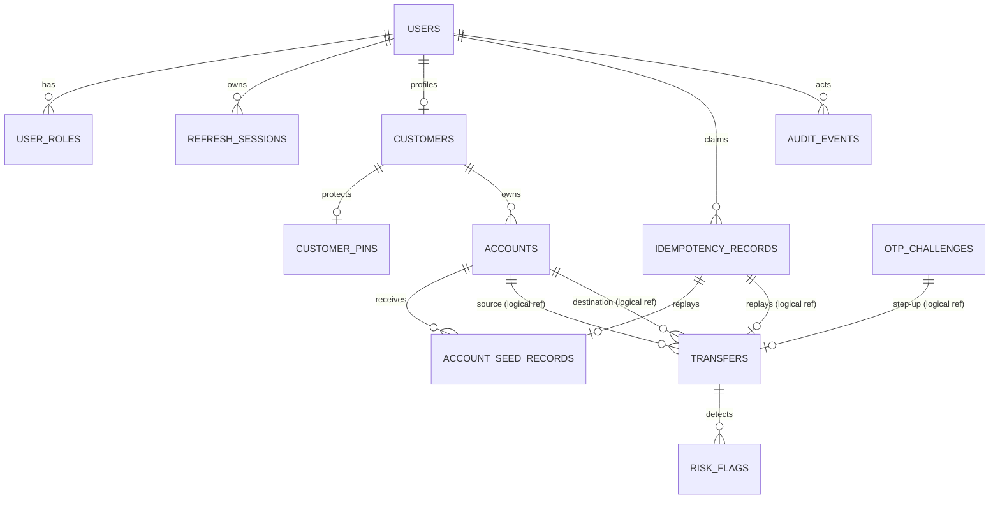
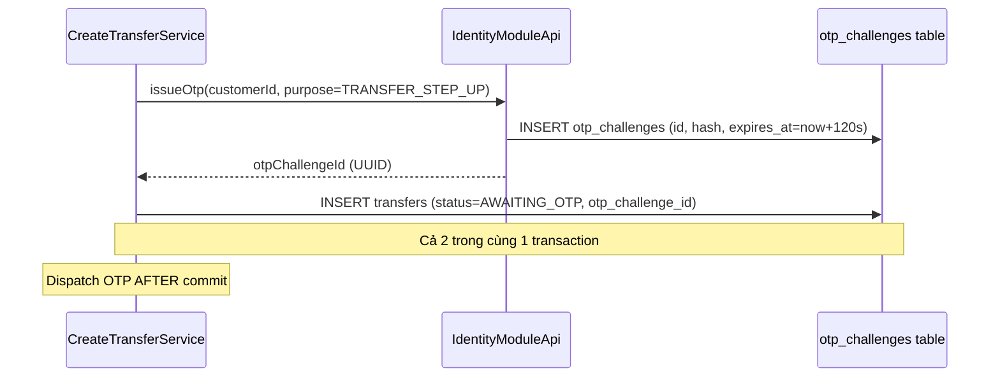
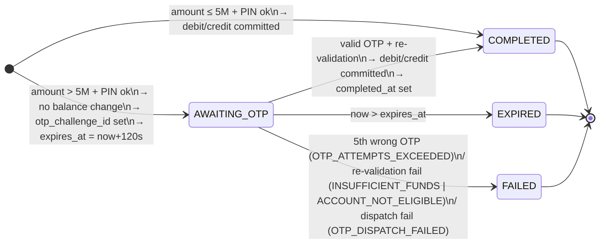

# 1. ERD — Entity Relationship Design

> Schema Database cho module Transfer.
> Source of truth: `contracts/openapi.yaml` + `docs_draft/projects/backend-mvp/database-architecture-design.md`
> Module `transfer` **sở hữu** bảng `transfers` và tham chiếu scalar UUID sang bảng của module khác.

---

## 1. Logical ERD — Toàn hệ thống (vị trí của transfer)



> **Chú ý:** Các quan hệ từ `TRANSFERS` sang các bảng của module khác là **logical reference** (scalar UUID), **không phải physical FK**. Module `transfer` không join cross-module trong business path.

---

## 2. Bảng `transfers` — Module ownership

Bảng duy nhất do module `transfer` sở hữu.

### DDL tham chiếu

```sql
CREATE TABLE transfers (
    id                     UUID         NOT NULL,
    source_account_id      UUID         NOT NULL,
    destination_account_id UUID         NOT NULL,
    amount                 NUMERIC(19,0) NOT NULL,
    currency               VARCHAR(3)   NOT NULL,
    status                 VARCHAR(20)  NOT NULL,
    failure_code           VARCHAR(80),
    memo                   VARCHAR(140),
    otp_challenge_id       UUID,
    idempotency_record_id  UUID,
    created_at             TIMESTAMPTZ  NOT NULL,
    expires_at             TIMESTAMPTZ,
    completed_at           TIMESTAMPTZ,
    updated_at             TIMESTAMPTZ  NOT NULL,

    CONSTRAINT transfers_pkey PRIMARY KEY (id),
    CONSTRAINT transfers_amount_range
        CHECK (amount >= 2000 AND amount <= 10000000),
    CONSTRAINT transfers_currency_vnd
        CHECK (currency = 'VND'),
    CONSTRAINT transfers_status_enum
        CHECK (status IN ('AWAITING_OTP','COMPLETED','EXPIRED','FAILED')),
    -- AWAITING_OTP bắt buộc có expires_at và otp_challenge_id
    CONSTRAINT transfers_awaiting_requires_expiry
        CHECK (status <> 'AWAITING_OTP' OR expires_at IS NOT NULL),
    CONSTRAINT transfers_awaiting_requires_otp
        CHECK (status <> 'AWAITING_OTP' OR otp_challenge_id IS NOT NULL),
    -- expires_at chỉ được set khi AWAITING_OTP
    CONSTRAINT transfers_expiry_only_awaiting
        CHECK (expires_at IS NULL OR status = 'AWAITING_OTP'),
    -- COMPLETED iff completed_at IS NOT NULL
    CONSTRAINT transfers_completed_at_iff_status
        CHECK (
            (status = 'COMPLETED' AND completed_at IS NOT NULL) OR
            (status <> 'COMPLETED' AND completed_at IS NULL)
        )
);
```

### Indexes

```sql
-- Phân trang lịch sử của source owner
CREATE INDEX idx_transfers_source_cursor
    ON transfers (source_account_id, created_at DESC, id DESC);

-- Phân trang lịch sử của destination owner (COMPLETED only)
CREATE INDEX idx_transfers_dest_cursor
    ON transfers (destination_account_id, created_at DESC, id DESC);

-- Expiration policy scan cho AWAITING_OTP
CREATE INDEX idx_transfers_awaiting_expiry
    ON transfers (expires_at)
    WHERE status = 'AWAITING_OTP';

-- Stable total-order cursor
CREATE INDEX idx_transfers_global_cursor
    ON transfers (created_at DESC, id DESC);

-- Unique OTP challenge per transfer
CREATE UNIQUE INDEX uq_transfers_otp_challenge
    ON transfers (otp_challenge_id)
    WHERE otp_challenge_id IS NOT NULL;

-- Risk high-frequency rule: COMPLETED source transfers trong time window
-- Sử dụng index source/created_at hiện có; thêm index riêng trên completed_at
-- chỉ sau khi EXPLAIN ANALYZE trên workload đại diện chứng minh cần.
```

### Cột chi tiết

| Cột | Kiểu | Null | Ý nghĩa |
|---|---|:---:|---|
| `id` | UUID | NO | PK — Transfer ID trả về client |
| `source_account_id` | UUID | NO | Logical ref → `accounts.id` (module account) |
| `destination_account_id` | UUID | NO | Logical ref → `accounts.id` |
| `amount` | NUMERIC(19,0) | NO | VNĐ nguyên, range [2000, 10,000,000] |
| `currency` | VARCHAR(3) | NO | MVP: `VND` |
| `status` | VARCHAR(20) | NO | `AWAITING_OTP`, `COMPLETED`, `EXPIRED`, `FAILED` |
| `failure_code` | VARCHAR(80) | YES | Required khi `FAILED`; e.g. `INSUFFICIENT_FUNDS`, `OTP_ATTEMPTS_EXCEEDED`, `OTP_DISPATCH_FAILED`, `ACCOUNT_NOT_ELIGIBLE` |
| `memo` | VARCHAR(140) | YES | Ghi chú tùy chọn |
| `otp_challenge_id` | UUID | YES | Logical ref → `otp_challenges.id` (module identity). Required khi `AWAITING_OTP` |
| `idempotency_record_id` | UUID | YES | Logical ref → `idempotency_records.id` (shared) |
| `created_at` | TIMESTAMPTZ | NO | Thời điểm tạo transfer |
| `expires_at` | TIMESTAMPTZ | YES | TTL 120s từ created_at; chỉ khi `AWAITING_OTP` |
| `completed_at` | TIMESTAMPTZ | YES | Required khi và chỉ khi `COMPLETED` |
| `updated_at` | TIMESTAMPTZ | NO | Timestamp cập nhật trạng thái cuối cùng |

---

## 3. Bảng `idempotency_records` — Shared module, transfer sử dụng

Bảng do `shared.idempotency` sở hữu. Transfer service gọi `TransferIdempotencyService` (adapter) để claim/replay.

### Schema tóm tắt

| Cột | Kiểu | Ý nghĩa |
|---|---|---|
| `id` | UUID | PK |
| `actor_id` | UUID | User ID của customer |
| `operation` | VARCHAR(120) | `createTransfer` |
| `idempotency_key` | VARCHAR(128) | Client-supplied, 16–128 chars |
| `request_hash` | CHAR(64) | SHA-256 của canonical payload (không có `pin`) |
| `response_status` | SMALLINT | HTTP status của kết quả gốc |
| `response_body` | JSONB | Body response gốc để replay |
| `resource_id` | UUID | `transfers.id` của transfer đã tạo |
| `created_at` | TIMESTAMPTZ | Claim time |
| `expires_at` | TIMESTAMPTZ | >= 24h từ created_at |

Unique constraint: `(actor_id, operation, idempotency_key)`.

### Canonical payload hash

Payload hash cho transfer:

```text
SHA-256(
  sourceAccountId=<UUID>,
  destinationAccountId=<UUID>,
  amount=<canonical-integer-string>,
  currency=VND,
  memo=<value-or-empty-string>
)
```

Thứ tự field cố định, lowercase key names, null memo = empty string. **`pin` không được đưa vào hash** (PIN được verify riêng mỗi lần gọi).

---

## 4. Bảng `otp_challenges` — Identity module, transfer tham chiếu

Module `transfer` nhận `otp_challenge_id` qua `IdentityModuleApi.issueOtp()` và lưu vào `transfers.otp_challenge_id`. Transfer không trực tiếp đọc/write bảng này.

### Sơ đồ lifecycle OTP trong context transfer



---

## 5. Bảng `risk_flags` — Risk module

Module `transfer` không write trực tiếp. Sau khi transfer commit, `RiskEvaluationService` chạy AFTER_COMMIT trong REQUIRES_NEW và insert vào `risk_flags`.

### Schema tóm tắt

| Cột | Kiểu | Ý nghĩa |
|---|---|---|
| `transfer_id` | UUID | Logical ref → `transfers.id` |
| `rule_id` | VARCHAR(80) | `LARGE_TRANSFER`, `HIGH_FREQUENCY` |
| `rule_version` | VARCHAR(40) | `1` |
| `reason` | VARCHAR(500) | Safe explanation |
| `detected_at` | TIMESTAMPTZ | Detection time |

Unique: `(transfer_id, rule_id, rule_version)`.

**Rules:**
- `LARGE_TRANSFER v1`: `amount > 5,000,000` VNĐ (5M không flag).
- `HIGH_FREQUENCY v1`: source account có > 5 COMPLETED transfers trong 10 phút.

---

## 6. State Machine & Invariants (DB-level)



**DB-level invariants được enforce bởi CHECK constraints:**

| Invariant | Constraint |
|---|---|
| `AWAITING_OTP` → `expires_at IS NOT NULL` | `transfers_awaiting_requires_expiry` |
| `AWAITING_OTP` → `otp_challenge_id IS NOT NULL` | `transfers_awaiting_requires_otp` |
| `expires_at IS NOT NULL` → `AWAITING_OTP` | `transfers_expiry_only_awaiting` |
| `COMPLETED` ↔ `completed_at IS NOT NULL` | `transfers_completed_at_iff_status` |
| Balance non-negative | `accounts.balance >= 0` (account module) |

---

## 7. Migration baseline

Các migration đã áp dụng (V1–V7). Module transfer liên quan đến:

| Version | Nội dung liên quan transfer |
|---|---|
| V3 | Tạo bảng `transfers`, `account_seed_records` |
| V5 | Thêm constraints và indexes cho transfer (AWAITING_OTP, expires_at, otp_challenge unique) |

**Nguyên tắc:** Không sửa migration đã apply. Chỉ thêm forward migration (V8+).

---

## 8. Không thêm trong MVP

Những column/table sau **không được thêm** vào schema transfer trong MVP:

- `available_balance`, `hold_amount` — không reserve trong AWAITING_OTP.
- `account_ledger_entries` — double-entry ledger là future option.
- `beneficiaries` — lưu người nhận thường xuyên là post-MVP.
- `soft_delete`, `deleted_at` — transfers là immutable financial records.
- Generic `version` column — pessimistic row lock đủ cho MVP.
