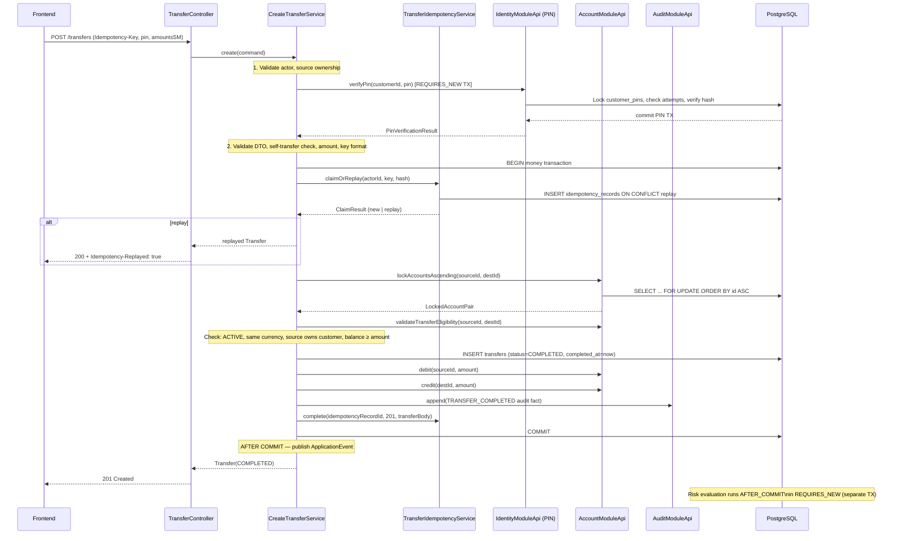
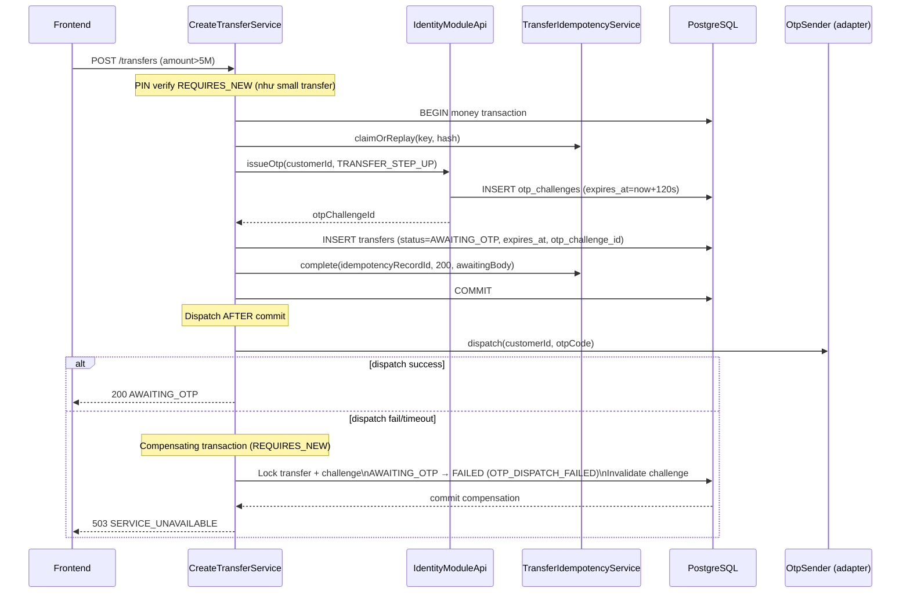
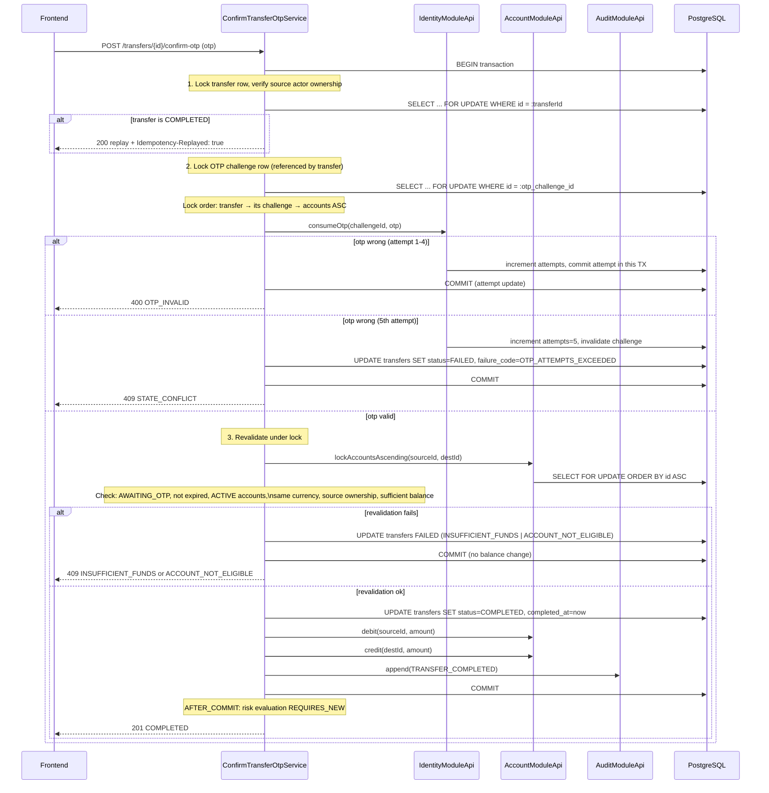

# 3. Architecture — Transfer Module Internal Design

> Chi tiết thiết kế nội bộ, luồng xử lý, concurrency strategy, và acceptance tests.
> Đây là tài liệu kỹ thuật cốt lõi của module transfer — phần không được viết trong `docs_draft`.

---

## 1. Package Structure

```text
com.bank.simulator.transfer/
├── api/
│   └── TransferModuleApi.java            # Public interface của module
├── application/
│   ├── ResolveRecipientService.java      # POST /recipients/resolve
│   ├── CreateTransferService.java        # POST /transfers
│   ├── ConfirmTransferOtpService.java    # POST /transfers/{id}/confirm-otp
│   ├── TransferQueryService.java         # GET /transfers, GET /transfers/{id}
│   └── TransferExpirationPolicy.java    # Lazy expiry evaluation
├── domain/
│   ├── Transfer.java                     # Aggregate root (immutable value object)
│   ├── TransferStatus.java               # Enum: AWAITING_OTP, COMPLETED, EXPIRED, FAILED
│   ├── TransferPolicy.java               # Business rules: threshold, limits, lock order
│   └── TransferLockOrder.java            # UUID comparison logic (PostgreSQL-ordered)
├── infrastructure/
│   └── persistence/
│       ├── TransferEntity.java           # JDBC entity mapping
│       ├── TransferRepository.java       # Core CRUD + state transitions
│       ├── TransferLockRepository.java   # Native SQL FOR UPDATE queries
│       └── TransferIdempotencyService.java # Claim/replay idempotency records
└── web/
    ├── RecipientController.java          # POST /recipients/resolve
    ├── TransferController.java           # Transfer CRUD + confirm-otp
    └── dto/
        ├── CreateTransferRequest.java
        ├── ConfirmOtpRequest.java
        ├── TransferResponse.java
        ├── TransferListResponse.java
        └── RecipientResponse.java
```

**Nguyên tắc:**
- `application/` services chỉ gọi module APIs và own repository adapters.
- Không có cross-module repository injection.
- `domain/` không phụ thuộc infrastructure.

---

## 2. Luồng xử lý: Small Transfer (≤ 5,000,000 VNĐ)

### Sequence



### Transaction boundary

**PIN transaction (REQUIRES_NEW):**
- Lock `customer_pins` row.
- Check failed attempts < 5, lock_until expired.
- Verify PIN hash.
- Increment/reset attempts, update lock state.
- Commit.

**Money transaction (REQUIRED):**
- Claim idempotency record.
- Lock accounts (ascending UUID).
- Validate eligibility under lock.
- Insert transfer row (COMPLETED).
- Debit source, credit destination.
- Append audit fact.
- Complete idempotency record.
- Commit.

**Sau commit (AFTER_COMMIT):**
- Publish `TransferCompletedEvent`.
- `RiskEvaluationService` (REQUIRES_NEW) evaluate rules, insert risk_flags nếu triggered.
- Risk failure **không** rollback transfer.

---

## 3. Luồng xử lý: Large Transfer (> 5,000,000 VNĐ) — Create Phase

### Sequence



**Race conditions với compensation:**
- Nếu concurrent confirm đã COMPLETED trước khi compensation chạy: compensation **không ghi đè** terminal state.
- Nếu expiry đã xảy ra: compensation **không ghi đè** EXPIRED state.
- `UPDATE transfers SET status='FAILED' WHERE id=:id AND status='AWAITING_OTP'` — điều kiện an toàn.

---

## 4. Luồng xử lý: Large Transfer — Confirm OTP Phase

### Sequence



**Critical design decision — OTP attempt commit:**
Theo design của `docs_draft/projects/backend-mvp/05-transfers.md`, sai OTP attempt 1–4 vẫn commit trong cùng transaction (không dùng nested REQUIRES_NEW cho wrong OTP). HTTP error mapping xảy ra **sau** commit để đảm bảo attempt count được lưu dù response bị lỗi.

---

## 5. Sorted Resource Locking — Deadlock Prevention

### Vấn đề

Khi A→B và B→A chạy đồng thời:
```
TX1: LOCK account_A → wait LOCK account_B
TX2: LOCK account_B → wait LOCK account_A
→ Deadlock!
```

### Giải pháp

Luôn lock theo thứ tự UUID ASC **do PostgreSQL quyết định**:

```sql
SELECT id, customer_id, balance, currency, status
FROM accounts
WHERE id IN (:account_a, :account_b)
ORDER BY id ASC
FOR UPDATE;
```

Với A→B: PostgreSQL lock min(A,B) first → max(A,B)
Với B→A: PostgreSQL lock min(A,B) first → max(A,B)
→ Cùng thứ tự → Không deadlock.

### Tại sao không dùng Java UUID comparison

Java `UUID.compareTo()` so sánh theo lexicographic byte order, có thể khác với PostgreSQL UUID ordering. Để đảm bảo consistency, dùng native SQL `ORDER BY id ASC FOR UPDATE`.

### Kiểm tra

```java
// TransferLockRepository.java
@Query(nativeQuery = true, value = """
    SELECT id, customer_id, balance, currency, status
    FROM accounts
    WHERE id IN (:accountA, :accountB)
    ORDER BY id ASC
    FOR UPDATE
    """)
List<AccountRow> lockAccountsAscending(@Param("accountA") UUID a, @Param("accountB") UUID b);
```

Verify bằng PostgreSQL `EXPLAIN (ANALYZE, BUFFERS)` để đảm bảo `ORDER BY id ASC FOR UPDATE` được thực thi đúng kế hoạch.

---

## 6. Money Parsing

```java
public BigDecimal parseAmount(String input) {
    // 1. Null/blank check
    if (input == null || input.isBlank()) throw new ValidationException(AMOUNT_INVALID);

    // 2. Regex: chỉ chữ số, không dấu, không khoảng trắng, không leading zero
    if (!input.matches("[1-9][0-9]*")) throw new ValidationException(AMOUNT_INVALID);

    // 3. Parse BigDecimal
    BigDecimal amount;
    try {
        amount = new BigDecimal(input);
    } catch (NumberFormatException e) {
        throw new ValidationException(AMOUNT_INVALID);
    }

    // 4. Scale phải là 0 (không phần thập phân)
    if (amount.scale() != 0) throw new ValidationException(AMOUNT_INVALID);

    // 5. Positive
    if (amount.signum() <= 0) throw new ValidationException(AMOUNT_INVALID);

    // 6. Canonical form (không có trailing zero, không scientific notation)
    if (!amount.toPlainString().equals(input)) throw new ValidationException(AMOUNT_INVALID);

    // 7. Range check
    if (amount.compareTo(TRANSFER_MIN) < 0 || amount.compareTo(TRANSFER_MAX) > 0)
        throw new ValidationException(AMOUNT_INVALID);

    return amount;
}
```

---

## 7. Idempotency Implementation

### Claim/Replay flow

```java
// TransferIdempotencyService.java
@Transactional(propagation = REQUIRED) // joins money transaction
public ClaimResult claimOrReplay(UUID actorId, String key, String payloadHash) {
    try {
        // INSERT ... ON CONFLICT DO NOTHING
        idempotencyRepository.insert(actorId, "createTransfer", key, payloadHash);
        return ClaimResult.NEW;
    } catch (DuplicateKeyException ex) {
        // Record đã tồn tại → lookup
        IdempotencyRecord record = idempotencyRepository.findByScope(actorId, "createTransfer", key)
            .orElseThrow(() -> new IllegalStateException("Race condition in idempotency claim"));

        if (!record.requestHash().equals(payloadHash)) {
            throw new ApiException(IDEMPOTENCY_KEY_REUSED);
        }

        // Same hash → replay
        return ClaimResult.REPLAY(record);
    }
}
```

### Canonical payload hash

```java
public String computePayloadHash(CreateTransferCommand cmd) {
    // Stable field order, normalized, memo null → ""
    String payload = String.format(
        "sourceAccountId=%s,destinationAccountId=%s,amount=%s,currency=%s,memo=%s",
        cmd.sourceAccountId(),
        cmd.destinationAccountId(),
        cmd.amount().toPlainString(),  // scale 0, no scientific notation
        cmd.currency(),
        cmd.memo() != null ? cmd.memo() : ""
    );
    return Hex.encodeHexString(
        MessageDigest.getInstance("SHA-256").digest(payload.getBytes(StandardCharsets.UTF_8))
    );
}
```

---

## 8. Transfer Expiration Policy

Expiry được evaluate **lazily** khi read/confirm, không cần scheduled job bắt buộc.

```java
// TransferExpirationPolicy.java
public TransferStatus resolveEffectiveStatus(Transfer transfer, Instant now) {
    if (transfer.status() == AWAITING_OTP
        && transfer.expiresAt() != null
        && now.isAfter(transfer.expiresAt())) {
        return EXPIRED;
    }
    return transfer.status();
}
```

Nếu có scheduled job để persist EXPIRED state: job phải dùng `UPDATE ... WHERE status = 'AWAITING_OTP' AND expires_at < now()` — không touch COMPLETED/FAILED.

---

## 9. Risk Integration

```java
// Trong ConfirmTransferOtpService / CreateTransferService
@TransactionalEventListener(phase = TransactionPhase.AFTER_COMMIT)
public void onTransferCompleted(TransferCompletedEvent event) {
    try {
        riskEvaluationService.evaluate(event.transferId());  // REQUIRES_NEW
    } catch (Exception ex) {
        log.warn("Risk evaluation failed for transfer {}: {}", event.transferId(), ex.getMessage());
        // Không re-throw: risk failure không được ảnh hưởng đến response của transfer
    }
}
```

**Đảm bảo:**
- `AFTER_COMMIT` listener chỉ chạy khi money transaction commit thành công → rollback không trigger.
- `RiskEvaluationService` dùng `@Transactional(REQUIRES_NEW)` → risk failure rollback độc lập.
- Catch failure ở listener level → không propagate sang HTTP layer.

---

## 10. Acceptance Tests Matrix

### Unit/Integration tests (không cần PostgreSQL)

| Test ID | Scenario | Assertion |
|---|---|---|
| UT-01 | Amount canonical: `"50000"` | parseAmount trả đúng BigDecimal |
| UT-02 | Amount sai: `"50000.5"`, `"0"`, `"-100"`, `"+100"`, `" 100"`, `"1e5"` | ValidationException |
| UT-03 | Amount range: `"1999"`, `"10000001"` | AMOUNT_INVALID |
| UT-04 | Self-transfer: sourceId == destId | 400 VALIDATION_ERROR |
| UT-05 | Payload hash: memo null và memo "" tạo cùng hash | True |
| UT-06 | Payload hash: thay đổi bất kỳ field → hash khác | True |

### PostgreSQL concurrency tests (Testcontainers)

| Test ID | Scenario | Setup | Assertion |
|---|---|---|---|
| CON-01 | Overdraft prevention | Source: 1M, 2×600K concurrent | 1 commit 201, 1 commit 409; source balance 400K; dest +600K; không âm |
| CON-02 | Same-key idempotency | N concurrent cùng actor/key/payload | 1 transfer tạo; replay trả original; khác payload → 409 |
| CON-03 | Opposite-direction no deadlock | A→B + B→A concurrent | Cả 2 complete hoặc 1 fail; không deadlock lâu dài; bounded timeout |
| CON-04 | Duplicate confirm | 2 concurrent confirm-otp trên AWAITING_OTP | 1 COMPLETED + 1 debit/credit; call sau replay 200 |
| CON-05 | Block-vs-confirm race | AWAITING_OTP → concurrent block + confirm | Confirm revalidate dưới lock → ineligible FAILED, balance unchanged |

### Failure injection tests

| Test ID | Scenario | Assertion |
|---|---|---|
| FI-01 | Rollback: inject throw sau debit trước credit | source/dest unchanged; không COMPLETED; không audit commit; không risk flag |
| FI-02 | Timeout-after-commit: retry cùng key | Original result; debit/credit đúng 1 lần |
| FI-03 | OTP dispatch fail → compensation | FAILED(OTP_DISPATCH_FAILED); AWAITING_OTP duy nhất; balance unchanged |
| FI-04 | Compensation race: confirm wins before compensation | COMPLETED preserved; compensation không ghi đè |
| FI-05 | App restart sau commit | Idempotency record tồn tại; retry → replay result |

### State machine tests

| Test ID | Scenario | Assertion |
|---|---|---|
| SM-01 | Terminal COMPLETED → không chuyển sang bất kỳ status nào | UPDATE fails |
| SM-02 | Terminal FAILED → confirm → 409 STATE_CONFLICT | Không mutation |
| SM-03 | Terminal EXPIRED → confirm → 409 TRANSFER_EXPIRED | Không mutation |
| SM-04 | 5M đúng threshold → small path | 201 COMPLETED |
| SM-05 | 5M+1 → large path | 200 AWAITING_OTP |

### Query và visibility tests

| Test ID | Scenario | Assertion |
|---|---|---|
| QV-01 | Source owner thấy AWAITING_OTP | 200 với item |
| QV-02 | Destination owner không thấy AWAITING_OTP/FAILED | 404 TRANSFER_NOT_FOUND (detail), empty list (list) |
| QV-03 | Destination owner thấy COMPLETED | 200 với item |
| QV-04 | Cursor tie-break: 2 transfers cùng created_at | Stable order theo id DESC |
| QV-05 | Malformed cursor | 400 VALIDATION_ERROR |
| QV-06 | Masking: counterpartyAccountMasked | Chỉ 4 số cuối visible |

---

## 11. Lệnh Test

```bash
# Unit tests cho module transfer
mvn -q -Dtest="*TransferServiceTest,*TransferServiceLifecycleTest,*TransferControllerMvcTest,*Recipient*Test" test

# PostgreSQL concurrency tests (cần Testcontainers)
mvn -q -Dtest="*Transfer*PostgresTest,TransferUiApiRegressionPostgresTest" test
```

**Testcontainers only** — Không dùng H2 cho concurrency test (H2 không chứng minh PostgreSQL row lock semantics).

---

## 12. Forbidden Patterns

| Pattern | Lý do cấm |
|---|---|
| `AccountRepository` inject vào transfer service | Vi phạm module boundary |
| Network call bên trong money transaction | Có thể gây long-hold lock, phức tạp rollback |
| OTP dispatch bên trong money transaction | Dispatch trước commit → OTP gửi dù transfer rollback |
| Float/double cho amount | Mất chính xác số học |
| `H2` cho PostgreSQL lock test | H2 không có `SELECT FOR UPDATE ORDER BY` semantics đúng |
| `sleep()` để sync concurrency test | Flaky; dùng `CountDownLatch` + `ExecutorService` |
| `if (testMode)` trong business code | Ô nhiễm logic; dùng Spring Profile + bean injection |
| Modify migration đã apply | Breaking; chỉ forward migration |
