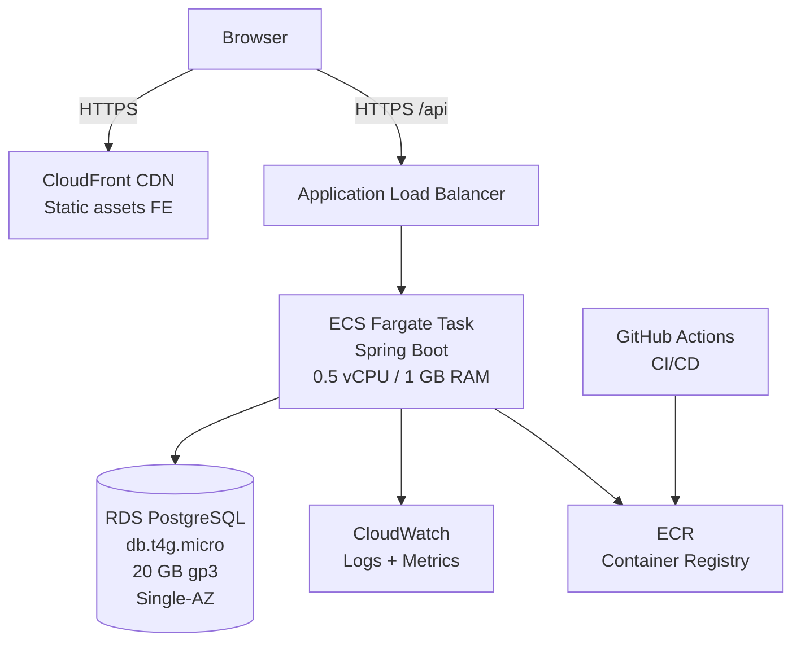

# 4. Deployment & Infrastructure

> Hạ tầng, observability, CI/CD và security controls cho module Transfer trong Digital Banking Simulator.
> Target environment: Cloud deployment (AWS) + Local development (Docker Compose).

---

## 1. Local Development Stack

### Docker Compose services

```yaml
# docker-compose.yml (tham chiếu — không sửa file gốc)
services:
  db:
    image: postgres:16
    environment:
      POSTGRES_DB: banking_simulator
      POSTGRES_USER: simulator
      POSTGRES_PASSWORD: ${DB_PASSWORD}
    ports:
      - "5432:5432"
    volumes:
      - postgres_data:/var/lib/postgresql/data

  backend:
    build: ./be
    environment:
      SPRING_DATASOURCE_URL: jdbc:postgresql://db:5432/banking_simulator
      SPRING_DATASOURCE_USERNAME: simulator
      SPRING_DATASOURCE_PASSWORD: ${DB_PASSWORD}
      APP_OTP_MAILBOX_ENABLED: "true"       # local mailbox adapter
      APP_SECURITY_ACCESS_TOKEN_TTL: 900s
    ports:
      - "8080:8080"
    depends_on:
      db:
        condition: service_healthy

  frontend:
    build: ./frontend
    environment:
      VITE_API_BASE_URL: http://localhost:8080/api/v1
    ports:
      - "5173:5173"
```

### Environment variables (module transfer relevant)

| Variable | Default | Mô tả |
|---|---|---|
| `APP_MONEY_TRANSFER_MIN` | `2000` | Transfer minimum (VNĐ) |
| `APP_MONEY_TRANSFER_MAX` | `10000000` | Transfer maximum (VNĐ) |
| `APP_MONEY_TRANSFER_OTP_THRESHOLD` | `5000000` | OTP step-up threshold |
| `APP_OTP_TTL` | `120s` | OTP TTL |
| `APP_OTP_MAX_ATTEMPTS` | `5` | OTP max attempts |
| `APP_OTP_MAILBOX_ENABLED` | `false` | Local OTP mailbox (local dev only) |
| `APP_IDEMPOTENCY_RETENTION` | `24h` | Idempotency key retention |
| `APP_RISK_LARGE_TRANSFER_THRESHOLD` | `5000000` | Risk LARGE_TRANSFER rule threshold |
| `APP_RISK_TRANSFER_COUNT_WINDOW` | `10m` | Risk HIGH_FREQUENCY time window |

**Tất cả limit được configure server-side; client không được gửi limit trong request.**

---

## 2. Application Configuration

```yaml
# application.yml — sections liên quan transfer
app:
  money:
    currency: VND
    transfer-min: 2000
    transfer-max: 10000000
    seed-max: 100000000
    transfer-otp-threshold: 5000000
  otp:
    length: 6
    ttl: 120s
    max-attempts: 5
    mailbox-enabled: false     # true chỉ cho local/demo profile
  idempotency:
    retention: 24h
  risk:
    large-transfer-threshold: 5000000
    transfer-count-window: 10m

spring:
  datasource:
    hikari:
      maximum-pool-size: 20
      minimum-idle: 5
      connection-timeout: 5000     # 5s
      idle-timeout: 600000         # 10m
      max-lifetime: 1800000        # 30m
      leak-detection-threshold: 60000  # 1m — phát hiện connection leak

  jpa:
    hibernate:
      ddl-auto: validate    # Flyway quản lý schema; JPA chỉ validate
    properties:
      hibernate:
        jdbc:
          time_zone: UTC
```

---

## 3. Cloud Deployment Architecture

### Target: AWS (Single Region — Singapore ap-southeast-1)



### Resource sizing (Planning estimate — chưa load-test xác nhận)

| Resource | Type | Spec | Estimated cost |
|---|---|---|---|
| Backend compute | ECS Fargate | 0.5 vCPU, 1 GB RAM | ~$15.20/tháng |
| Database | RDS PostgreSQL | db.t4g.micro, Single-AZ, 20 GB gp3 | ~$16.50/tháng |
| Frontend hosting | S3 + CloudFront | Static assets | ~$1.80/tháng |
| Load Balancer | ALB | 1 ALB | ~$10.00/tháng |
| Logging | CloudWatch | 5 GB logs | ~$3.50/tháng |
| **Tổng listed** | | | **~$45–50/tháng** |

> ⚠️ Đây là planning estimate, không phải price quote. Cần verify thêm: data transfer, backup, ECR, IPv4, NAT, domain, monitoring overage.

### Alternative: Free-tier / Hobby

- Có thể đạt $0 trong quota miễn phí nhưng không bảo đảm.
- **Không dùng auto-suspend database** cho load test liên tục 20 RPS.
- Phù hợp cho demo tĩnh, không phù hợp cho performance test.

---

## 4. CI/CD Pipeline (GitHub Actions)

```yaml
# .github/workflows/ci.yml — tham chiếu
name: CI/CD Pipeline
on:
  push:
    branches: [main, develop]
  pull_request:
    branches: [main]

jobs:
  backend:
    runs-on: ubuntu-latest
    steps:
      - uses: actions/checkout@v4

      # 1. Validate OpenAPI contract
      - name: Validate OpenAPI
        run: npx @stoplight/spectral-cli lint contracts/openapi.yaml

      # 2. Run targeted unit tests
      - name: Unit Tests
        run: |
          cd be
          mvn -q -Dtest="*TransferServiceTest,*TransferServiceLifecycleTest,\
            *TransferControllerMvcTest,*Recipient*Test" test

      # 3. Run PostgreSQL integration tests (Testcontainers)
      - name: PostgreSQL Integration Tests
        run: |
          cd be
          mvn -q -Dtest="*Transfer*PostgresTest,TransferUiApiRegressionPostgresTest" test

      # 4. Build Docker image
      - name: Build & Push
        if: github.ref == 'refs/heads/main'
        run: |
          docker build -t $ECR_REGISTRY/banking-simulator:$GITHUB_SHA ./be
          docker push $ECR_REGISTRY/banking-simulator:$GITHUB_SHA

      # 5. Deploy to ECS (main branch only)
      - name: Deploy
        if: github.ref == 'refs/heads/main'
        run: |
          aws ecs update-service \
            --cluster banking-simulator \
            --service backend \
            --force-new-deployment
```

### CI gates

| Gate | Tool | Condition to pass |
|---|---|---|
| OpenAPI validation | Spectral | No linting errors |
| Unit tests | Maven + JUnit | 100% pass |
| PostgreSQL tests | Maven + Testcontainers | 100% pass |
| Static analysis | Maven Checkstyle | No violations |
| Docker build | Docker | Build succeeds |

---

## 5. Observability

### 5.1 Health Check

```text
GET /api/v1/health
→ 200: { "status": "UP", "db": "UP" }
→ 503: { "status": "DOWN", "db": "DOWN" }
```

Kiểm tra: DB connectivity, HikariCP pool available. Load balancer health check dùng endpoint này.

### 5.2 Structured Logging

```json
{
  "timestamp": "2026-10-19T07:30:00.123Z",
  "level": "INFO",
  "logger": "c.b.s.transfer.application.CreateTransferService",
  "correlationId": "47ec3533-9b7f-408c-a143-ab3918e56446",
  "actorId": "ad1f67a1-6a9f-4c11-a3c4-bc01f6ac4350",
  "transferId": "7a2327ae-b132-44a5-b682-982842717213",
  "message": "Transfer completed",
  "amount": 50000,
  "status": "COMPLETED"
}
```

**Không bao giờ log:**
- PIN, OTP, password, token, secret.
- Full account number.
- Personal contact info (phone, email).

**MDC keys propagated:**
- `correlationId` — từ `X-Correlation-Id` header hoặc tự sinh.
- `actorId` — từ JWT claim.

### 5.3 Metrics (Spring Actuator + Prometheus)

#### Transfer-specific metrics

| Metric | Type | Labels | Mô tả |
|---|---|---|---|
| `transfer.created.total` | Counter | `status` (COMPLETED/AWAITING_OTP) | Số transfer được tạo |
| `transfer.completed.total` | Counter | `path` (direct/otp_confirm) | Số transfer hoàn thành |
| `transfer.failed.total` | Counter | `failure_code` | Số transfer thất bại |
| `transfer.otp.attempts.histogram` | Histogram | — | Số OTP attempt trước khi thành công |
| `transfer.idempotency.replayed.total` | Counter | — | Số replay request |
| `transfer.amount.histogram` | Histogram | — | Phân phối amount |
| `risk.flags.total` | Counter | `rule_id` | Số risk flag theo rule |

#### Infrastructure metrics

| Metric | Mô tả |
|---|---|
| `hikaricp.connections.active` | DB connections đang dùng |
| `hikaricp.connections.pending` | Requests chờ connection |
| `http.server.requests` | Latency per endpoint + status |
| `jvm.memory.used` | JVM heap usage |

#### SLO targets (from NFRs)

| SLO | Target | Alert threshold |
|---|---|---|
| Transfer p95 latency | ≤ 500 ms at 20 RPS | > 500 ms sustained 2 phút |
| Availability | ≥ 99.5% valid requests | 5xx rate > 1% for 1 minute |
| Financial invariant | 100% — zero negative balance | Any violation = immediate alert |
| Idempotency | 100% — zero duplicate debit | Any duplicate = immediate alert |

### 5.4 CloudWatch Dashboard

Panels:
1. **API Latency** — p50/p95/p99 per endpoint (transfer-related)
2. **Transfer outcomes** — COMPLETED/AWAITING_OTP/FAILED rate per minute
3. **Risk flags** — LARGE_TRANSFER/HIGH_FREQUENCY per hour
4. **DB connections** — HikariCP active/idle/pending
5. **Error rate** — 4xx vs 5xx breakdown
6. **JVM health** — heap used, GC pause time

---

## 6. Security Controls (Transfer-specific)

### 6.1 Authentication & Authorization

```java
// TransferController security annotations
@RestController
@RequestMapping("/api/v1")
public class TransferController {

    @PostMapping("/recipients/resolve")
    @PreAuthorize("hasRole('CUSTOMER')")
    public ResponseEntity<RecipientResponse> resolve(...) { ... }

    @PostMapping("/transfers")
    @PreAuthorize("hasRole('CUSTOMER')")
    public ResponseEntity<TransferResponse> create(...) { ... }

    @PostMapping("/transfers/{transferId}/confirm-otp")
    @PreAuthorize("hasRole('CUSTOMER')")
    public ResponseEntity<TransferResponse> confirmOtp(...) { ... }

    @GetMapping("/transfers")
    @PreAuthorize("hasRole('CUSTOMER')")
    public ResponseEntity<TransferListResponse> list(...) { ... }

    @GetMapping("/transfers/{transferId}")
    @PreAuthorize("hasAnyRole('CUSTOMER','OPERATOR','AUDITOR','ADMIN')")
    public ResponseEntity<TransferResponse> get(...) { ... }
}
```

### 6.2 IDOR Prevention

- Transfer ownership check trong service layer: `transfer.sourceAccountId().equals(actorAccount.id())`.
- Destination owner requesting non-COMPLETED transfer → `404 TRANSFER_NOT_FOUND` (concealment, không tiết lộ transfer tồn tại).
- Không infer ownership từ URL parameter — luôn validate từ JWT claim.

### 6.3 Rate Limiting

| Endpoint | Limit | Scope |
|---|---|---|
| `POST /recipients/resolve` | 30/min | Per customer UUID |
| `POST /transfers` | Xem `docs_draft/baseline` | Per customer |
| `POST /transfers/{id}/confirm-otp` | Unlimited (OTP attempt limit là 5) | Per transfer |

### 6.4 Input Sanitization

- Amount: strict regex + BigDecimal parsing (không dùng Float.parseFloat).
- Memo: max 140 chars, trim.
- Account number: 8–34 digits regex.
- OTP: exactly 6 digits.
- Cursor: Base64 URL-safe decode, JSON parse, validate version/timestamp/UUID.
- `Idempotency-Key`: 16–128 printable ASCII.

### 6.5 Sensitive Data Handling

- PIN không bao giờ được log hoặc đưa vào payload hash.
- OTP không log trong production.
- Audit record không chứa PIN, OTP, token.
- API response không trả full account number — chỉ masked (`••••4821`).
- `counterpartyDisplayName` trong list: limited display name, không có phone/email/address.

---

## 7. Database Security

### Connection

- Connection string qua environment variable (không hardcode).
- Dedicated DB user với minimal privileges (không `SUPERUSER`).
- TLS required cho DB connection trong cloud (sslmode=require).

### Schema protection

- Flyway migration: forward-only, không edit đã apply.
- Non-negative balance constraint ở DB level — defense in depth.
- No soft-delete columns trên `transfers` — immutable financial records.

---

## 8. Failure & Recovery Scenarios (Transfer)

### 8.1 Client timeout sau khi server commit

```text
Client → POST /transfers (Idempotency-Key: K1)
Server: commit thành công
→ Network timeout, client không nhận response

Client retry: POST /transfers (Idempotency-Key: K1, same payload)
Server: detect K1 đã committed
→ 200 + Idempotency-Replayed: true + original body

Kết quả: 1 debit/credit duy nhất
```

### 8.2 Application crash sau commit trước dispatch

```text
Server: commit AWAITING_OTP + OTP challenge
→ App crash trước khi dispatch OTP

Client: không nhận response
→ Retry cùng key → replay AWAITING_OTP (không dispatch OTP mới)
→ Customer gọi confirm-otp nhưng chưa có OTP

Accepted limitation: Transfer ở trạng thái AWAITING_OTP cho đến khi expires (120s)
→ Không phải bug; không có delivery guarantee trong MVP
```

### 8.3 DB unavailable

```text
Request → Backend nhận
→ DB connection unavailable
→ HikariCP timeout (5s)
→ 503 SERVICE_UNAVAILABLE (Fail-Closed)
→ Không ghi trạng thái success ảo
→ /health trả 503 → Load balancer stop routing

Recovery:
→ DB restored → health check pass → Load balancer resume
→ Client retry với cùng Idempotency-Key
```

### 8.4 Opposite-direction deadlock

```text
TX1: A→B concurrent TX2: B→A
Both use: SELECT FROM accounts WHERE id IN (A,B) ORDER BY id ASC FOR UPDATE
→ min(A,B) locked first by both
→ No deadlock
→ One gets lock, other waits
→ Both complete eventually (or timeout → 503 retriable)
```

---

## 9. Load Test Target (Module Transfer)

### Workload profile

| Metric | Target |
|---|---|
| Steady load | 20 RPS (mix: create + confirm + query) |
| Duration | 10 phút |
| Concurrent users | 50 simulated |
| Peak burst | 50 RPS |

### KPIs

| KPI | MVP acceptance | Stretch |
|---|---|---|
| Transfer create p95 | ≤ 500 ms | ≤ 350 ms |
| Transfer history p95 | ≤ 300 ms | ≤ 150 ms |
| Error rate (5xx) | < 0.5% | < 0.1% |
| Zero negative balance | 100% | 100% |
| Zero duplicate debit | 100% | 100% |

### Load test script structure (k6)

```javascript
// tests/load/transfer-load.js (tham chiếu)
import http from 'k6/http';
import { check, sleep } from 'k6';

export const options = {
  stages: [
    { duration: '1m', target: 20 },   // ramp up
    { duration: '8m', target: 20 },   // steady
    { duration: '1m', target: 0 },    // ramp down
  ],
  thresholds: {
    'http_req_duration{name:create_transfer}': ['p(95)<500'],
    'http_req_duration{name:get_transfers}': ['p(95)<300'],
    'http_req_failed': ['rate<0.005'],
  },
};
```

**Báo cáo phải bao gồm:** machine shape, DB size, seed data, concurrency profile, run date, p50/p95/p99, error rate, HikariCP pool stats.
