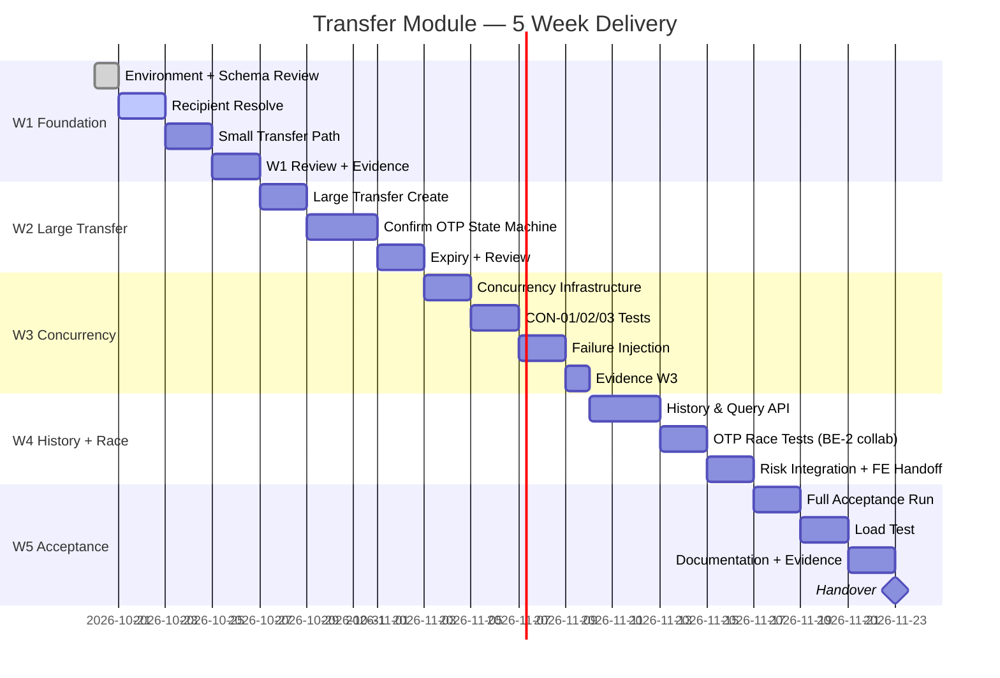

# 5. Timelines — 5-Week Delivery Plan

> **Start date:** Tuần 1 bắt đầu từ ngày 20/10/2026 (tuần sau ngày tạo harness này: 19/10/2026).
> **Owner:** BE-3 — module `transfer`.
> **Dependencies:** BE-1 (PIN/OTP), BE-2 (Account lock API), BE-4 (DisposablePostgresTestSupport).
> **Scope:** Module transfer end-to-end: schema, API, small/large transfer, OTP confirm, concurrency, history, risk integration, acceptance.

---

## Tổng quan 5 tuần

| Tuần | Focus | Milestone chính |
|---|---|---|
| **W1** | Foundation + Recipient + Small Transfer | Schema review, state machine, recipient resolve, small transfer (≤5M) pass unit test |
| **W2** | Large Transfer + OTP Lifecycle | AWAITING_OTP, dispatch, confirm, expiry, compensation |
| **W3** | Concurrency + Idempotency + Failure Injection | CON-01..03, idempotency race, rollback injection, timeout-after-commit |
| **W4** | History + Visibility + OTP Race + Risk | Pagination cursor, visibility rules, block-vs-confirm, risk AFTER_COMMIT |
| **W5** | Acceptance + Load Test + Documentation | Full matrix pass, k6 load test, evidence, handover |

---

## Tuần 1 — Foundation, Recipient Resolve, Small Transfer

**Dates:** 20/10 – 26/10/2026

### Goals

- [ ] Đọc và xác nhận state machine + boundary hiện tại (code khác docs → ghi MISMATCH vào evidence)
- [ ] Vẽ state diagram trên giấy/mermaid và ghi vào evidence `BE3-rollback-timeout.md`
- [ ] Thiết lập môi trường: Docker Compose, PostgreSQL local, migrations V1–V7 apply OK
- [ ] Implement `ResolveRecipientService` + test
- [ ] Implement `CreateTransferService` — small transfer path (≤5M)
- [ ] Unit tests pass: UT-01 → UT-06 (money parsing, self-transfer, hash)

### Tasks chi tiết

#### Day 1 (20/10) — Environment + State Machine Review

```bash
# Verify local setup
docker compose up -d
cd be && mvn validate

# Check migrations
# Verify V1..V7 applied correctly
```

- [ ] Đọc codebase hiện tại: `transfer/**` package
- [ ] So sánh implementation với `docs_draft/projects/backend-mvp/05-transfers.md`
- [ ] Ghi MISMATCH nếu có vào `week1/BE3-rollback-timeout.md`
- [ ] Vẽ state machine thực tế

#### Day 2–3 (21–22/10) — Recipient Resolve

- [ ] `ResolveRecipientService.resolve(actorId, accountNumber)`
  - Gọi `AccountModuleApi.findByAccountNumber()`
  - Validate: ACTIVE, VND, không phải tài khoản của actor
  - Rate limit check (30/min/customer)
- [ ] `RecipientController.POST /recipients/resolve`
- [ ] Unit test: exists/active → 200; not found/blocked → 404; rate limited → 429

#### Day 4–5 (23–24/10) — Small Transfer Path

- [ ] `CreateTransferService.create()` — small transfer path:
  1. Validate actor + source ownership
  2. PIN verify (REQUIRES_NEW)
  3. Validate DTO, amount parsing
  4. Canonicalize hash
  5. Claim/replay idempotency
  6. Lock accounts (ascending UUID)
  7. Validate eligibility under lock
  8. Insert COMPLETED, debit, credit, audit
  9. Commit → return 201
- [ ] Unit tests: amount parsing (UT-01..UT-03), self-transfer, PIN invalid/locked

#### Day 6–7 (25–26/10) — Review + Evidence

- [ ] Review diff, ghi evidence vào `week1/`
- [ ] Đảm bảo không sửa file của module khác

### Deliverables W1

- [ ] `transfer/application/ResolveRecipientService.java` + tests
- [ ] `transfer/application/CreateTransferService.java` (small path) + tests
- [ ] `week1/BE3-rollback-timeout.md` (mục hiện trạng + state machine)
- [ ] Unit test suite pass: money parsing, recipient resolve, small transfer happy path

### Dependencies W1

| Dependency | Owner | Fallback |
|---|---|---|
| `AccountModuleApi.findByAccountNumber()` | BE-2 | Mock với agreed signature |
| `IdentityModuleApi.verifyPin()` | BE-1 | Mock với agreed signature |
| `AuditModuleApi.append()` | BE-4 | Mock |

---

## Tuần 2 — Large Transfer + OTP Lifecycle

**Dates:** 27/10 – 2/11/2026

### Goals

- [ ] Implement large transfer create (>5M): AWAITING_OTP, issue OTP, commit challenge
- [ ] Implement OTP dispatch + compensation trên dispatch fail
- [ ] Implement `ConfirmTransferOtpService` — confirm state machine
- [ ] Implement `TransferExpirationPolicy` (lazy expiry)
- [ ] Tests: AWAITING_OTP lifecycle, wrong OTP attempts 1–5, expired confirm

### Tasks chi tiết

#### Day 1–2 (27–28/10) — Large Transfer Create

- [ ] Extend `CreateTransferService.create()` — large path:
  1. PIN verify REQUIRES_NEW (giống small)
  2. Claim idempotency
  3. `issueOtp(customerId, TRANSFER_STEP_UP)` → otpChallengeId
  4. INSERT transfers(AWAITING_OTP, expires_at=now+120s, otp_challenge_id)
  5. Commit (trước dispatch!)
  6. Dispatch OTP (local mailbox adapter)
  7. Dispatch fail → compensation REQUIRES_NEW (AWAITING_OTP → FAILED + invalidate challenge)
- [ ] Tests: 200 AWAITING_OTP; dispatch fail → 503; same-key replay → current state

#### Day 3–5 (29–31/10) — Confirm OTP

- [ ] `ConfirmTransferOtpService.confirm()`:
  1. Lock transfer + verify source ownership
  2. If COMPLETED → replay 200
  3. Lock OTP challenge
  4. Consume OTP (wrong 1–4 → commit attempts → 400; wrong 5th → FAILED → commit → 409)
  5. Valid OTP → lock accounts asc, re-validate, debit/credit, COMPLETED
  6. AFTER_COMMIT → risk event
- [ ] Tests: SM-01..SM-05 (state machine), wrong OTP attempts 1–5, expiry, revalidation fail

#### Day 6–7 (1–2/11) — Expiry + Review

- [ ] `TransferExpirationPolicy.resolveEffectiveStatus()`
- [ ] GET /transfers/{id}: lazy expiry evaluation
- [ ] Review diff, update evidence

### Deliverables W2

- [ ] Large transfer create + dispatch + compensation
- [ ] Confirm OTP full state machine
- [ ] Expiry policy
- [ ] `week1/` (hoặc tạo `week2/`) evidence với test output

### Dependencies W2

| Dependency | Owner | Fallback |
|---|---|---|
| `IdentityModuleApi.issueOtp()` | BE-1 | Mock local mailbox |
| `IdentityModuleApi.consumeOtp()` | BE-1 | Test fixture |
| `DisposablePostgresTestSupport` | BE-4 | Testcontainers tự quản lý (tạm thời) |

---

## Tuần 3 — Concurrency, Idempotency, Failure Injection

**Dates:** 3/11 – 9/11/2026

### Goals

- [ ] PostgreSQL concurrency tests: CON-01 (overdraft), CON-02 (same-key race), CON-03 (opposite deadlock)
- [ ] Failure injection: FI-01 (rollback after debit), FI-02 (timeout-after-commit), FI-03 (dispatch fail compensation)
- [ ] Chứng minh: lock order đúng, không negative balance, không duplicate debit
- [ ] Dùng `DisposablePostgresTestSupport` của BE-4 (không tạo container riêng)

### Tasks chi tiết

#### Day 1–2 (3–4/11) — Setup Concurrency Infrastructure

- [ ] Verify `DisposablePostgresTestSupport` available từ BE-4
- [ ] Thiết lập test pattern: `CountDownLatch` + `ExecutorService` + `Future.get(timeout)`
- [ ] Không dùng `sleep()` để synchronize

```java
// Pattern chuẩn
CountDownLatch startLatch = new CountDownLatch(1);
CountDownLatch doneLatch = new CountDownLatch(2);
ExecutorService executor = Executors.newFixedThreadPool(2);

Future<Result> tx1 = executor.submit(() -> {
    startLatch.await();
    return transferService.create(cmd1);
});
Future<Result> tx2 = executor.submit(() -> {
    startLatch.await();
    return transferService.create(cmd2);
});

startLatch.countDown(); // fire both at once
tx1.get(5, SECONDS);
tx2.get(5, SECONDS);
executor.shutdown();
```

#### Day 3–4 (5–6/11) — Concurrency Tests

- [ ] CON-01: Source 1M, 2×600K concurrent
  - Seed: source=1M, dest=0
  - Fire 2 concurrent creates (600K each)
  - Assert: 1 commit 201, 1 commit 409 INSUFFICIENT_FUNDS
  - Assert: source balance = 400K, dest = 600K; không âm
- [ ] CON-02: Same-key idempotency race
  - N concurrent cùng actor/key/payload
  - Assert: 1 transfer created; all get same response; balance changed once
  - Khác payload → exactly 1 gets 409 IDEMPOTENCY_KEY_REUSED
- [ ] CON-03: Opposite-direction deadlock
  - Seed: A=500K, B=500K
  - Concurrent: TX1=A→B(100K), TX2=B→A(100K)
  - Assert: cả 2 complete (hoặc 1 503 timeout); không deadlock lâu dài; bounded 5s timeout

#### Day 5–6 (7–8/11) — Failure Injection

- [ ] `TransferFailureInjector` (test-only bean, no-op trên prod profile):
  ```java
  // prod = no-op
  // test profile: throw exception tại điểm chỉ định
  public interface TransferFailureInjector {
      void afterDebitBeforeCredit(); // throw nếu test profile configured
  }
  ```
- [ ] FI-01: Inject throw sau debit → rollback
  - Assert: source/dest unchanged; không COMPLETED; không audit committed
- [ ] FI-02: Simulate timeout sau commit
  - Inject delay sau commit → client không nhận response
  - Retry cùng key → 200 replay original result
  - Assert: chỉ 1 debit/credit

#### Day 7 (9/11) — Evidence + Ghi kết quả

- [ ] Ghi vào `evidence/BE3-concurrency.md`: balance trước/sau + row counts
- [ ] Ghi vào `evidence/BE3-rollback-timeout.md`: kết quả rollback và timeout tests

### Deliverables W3

- [ ] CON-01, CON-02, CON-03 tests pass với PostgreSQL/Testcontainers
- [ ] FI-01, FI-02, FI-03 tests pass
- [ ] `evidence/BE3-concurrency.md`
- [ ] `evidence/BE3-rollback-timeout.md`

---

## Tuần 4 — History, Visibility, OTP Race, Risk

**Dates:** 10/11 – 16/11/2026

### Goals

- [ ] `TransferQueryService`: list với cursor pagination, filter, visibility rules
- [ ] GET /transfers/{id}: detail với visibility rules
- [ ] CON-04 (duplicate confirm) + CON-05 (block-vs-confirm race) với BE-2
- [ ] Risk AFTER_COMMIT integration test
- [ ] FE handoff: state/error matrix

### Tasks chi tiết

#### Day 1–3 (10–12/11) — History & Query

- [ ] `TransferQueryService.listTransfers()`:
  - Cursor encoding/decoding: CursorPosition → JSON → Base64 URL-safe
  - SQL: `WHERE (created_at < :t) OR (created_at = :t AND id < :id) ORDER BY created_at DESC, id DESC LIMIT :n+1`
  - Visibility: source owner = all statuses; destination owner = COMPLETED only
  - Filter: status, from (inclusive), to (exclusive)
  - `limit+1` trick để check next page
- [ ] `TransferQueryService.getTransfer()`: detail với concealment rule
- [ ] Tests: QV-01..QV-06 (visibility, cursor, masking)

#### Day 4–5 (13–14/11) — OTP Race Tests (phối hợp BE-2)

- [ ] CON-04: Duplicate confirm
  - 2 concurrent confirms trên cùng AWAITING_OTP
  - Assert: 1 COMPLETED, 1 replay 200; chỉ 1 debit/credit
- [ ] CON-05: Block-vs-confirm race
  - AWAITING_OTP → concurrent block (BE-2) + confirm (BE-3)
  - Confirm revalidate dưới lock → nếu blocked → FAILED(ACCOUNT_NOT_ELIGIBLE)
  - Assert: balance unchanged, terminal không ghi đè
- [ ] Ghi `evidence/BE3-otp-race.md`

#### Day 6–7 (15–16/11) — Risk Integration + FE Handoff

- [ ] Verify risk AFTER_COMMIT integration:
  - LARGE_TRANSFER flag sau transfer > 5M COMPLETED
  - HIGH_FREQUENCY flag sau > 5 transfers/10min
  - Risk failure không ảnh hưởng transfer response
- [ ] Chuẩn bị FE handoff error matrix:
  - State machine flow chart
  - 5M boundary
  - Header/body/key/retry protocol
  - Timeout unknown + reconcile guide
  - OTP attempt/expiry behavior

### Deliverables W4

- [ ] History API pass QV-01..QV-06
- [ ] CON-04, CON-05 pass
- [ ] Risk integration test pass
- [ ] `evidence/BE3-otp-race.md`
- [ ] FE handoff error matrix document

---

## Tuần 5 — Acceptance, Load Test, Documentation

**Dates:** 17/11 – 23/11/2026

### Goals

- [ ] Full acceptance matrix pass (tất cả test IDs từ Architecture.md §10)
- [ ] Load test: 20 RPS steady × 10 phút với transfer mix
- [ ] Evidence review + documentation finalize
- [ ] Handover sang BE-1, BE-2, BE-4, FE

### Tasks chi tiết

#### Day 1–2 (17–18/11) — Full Acceptance Run

```bash
# Run toàn bộ transfer tests
mvn -q -Dtest="*Transfer*,*Recipient*" test

# Run PostgreSQL tests
mvn -q -Dtest="*Transfer*PostgresTest,TransferUiApiRegressionPostgresTest" test

# Check git diff
git diff --check
```

- [ ] Pass tất cả acceptance criteria trong Architecture.md §10
- [ ] Ghi actual kết quả vào evidence

#### Day 3–4 (19–20/11) — Load Test

```bash
# k6 load test
k6 run tests/load/transfer-load.js

# Output: p50/p95/p99, error rate, transfer outcome counts
```

- [ ] Báo cáo: machine shape, DB size, seed data, p50/p95/p99, error rate, HikariCP stats
- [ ] Verify: transfer p95 ≤ 500ms, zero negative balance, zero duplicate debit

#### Day 5–6 (21–22/11) — Documentation + Evidence

- [ ] Update tất cả files trong `docs transactions/plans/`
- [ ] Finalize `evidence/` folder với test output
- [ ] Review `docs_draft` interface contracts — đảm bảo module boundary correct

#### Day 7 (23/11) — Handover

Bàn giao:
- **BE-1:** PIN/OTP boundary thực tế, wrong-attempt commit behavior
- **BE-2:** Lock/order validation, block race setup, concurrent account access
- **BE-4:** Failure injector design, PostgreSQL test output, invariant summary
- **FE:** State machine, 5M boundary, error matrix, timeout/unknown handling, OTP attempt/expiry

### Deliverables W5

- [ ] Tất cả acceptance criteria pass và có evidence
- [ ] Load test report (p50/p95/p99, error rate, machine shape)
- [ ] `docs transactions/plans/` hoàn chỉnh
- [ ] `evidence/BE3-*.md` đủ 3 files (rollback-timeout, concurrency, otp-race)
- [ ] Handover notes cho các team members

---

## Milestone Timeline Chart



---

## Acceptance Criteria tổng hợp

Trước khi mark **Done**, tất cả checklist sau phải pass và có evidence:

### Financial Invariants

- [ ] Rollback: source/dest balance unchanged sau failed transaction
- [ ] Zero negative balance dưới concurrent overdraft attempt
- [ ] Timeout retry trả original result, 1 debit/credit duy nhất
- [ ] Opposite-direction không deadlock lâu dài

### State Machine

- [ ] ≤5M → COMPLETED ngay (1 DB transaction)
- [ ] >5M → AWAITING_OTP; không trừ/giữ tiền; expires_at = now+120s
- [ ] OTP đúng + re-validation ok → COMPLETED; debit/credit committed
- [ ] OTP sai 1–4 → 400 OTP_INVALID; status vẫn AWAITING_OTP; attempts committed
- [ ] OTP sai lần 5 → FAILED(OTP_ATTEMPTS_EXCEEDED); 409 STATE_CONFLICT
- [ ] Expired → EXPIRED/409 TRANSFER_EXPIRED; balance unchanged
- [ ] Terminal không ghi đè: COMPLETED/EXPIRED/FAILED → final

### Idempotency

- [ ] Same key + same payload → 1 transfer; replay trả result gốc
- [ ] Same key + khác payload → 409 IDEMPOTENCY_KEY_REUSED; không mutation
- [ ] Concurrent same key → 1 resource (DB unique constraint)
- [ ] Duplicate confirm → 1 debit/credit; replay 200

### Query & Visibility

- [ ] Source owner thấy mọi status
- [ ] Destination owner chỉ thấy COMPLETED
- [ ] Destination confirm on non-completed → 404 TRANSFER_NOT_FOUND
- [ ] Cursor stable, tie-break đúng, malformed → 400

### Security

- [ ] PIN invalid → 400; PIN locked → 403; không bước vào OTP
- [ ] IDOR: customer không truy cập transfer của customer khác
- [ ] Wrong-attempt state committed trước HTTP error response

### Infrastructure

- [ ] Dùng `DisposablePostgresTestSupport` của BE-4 (không container riêng)
- [ ] H2 không được dùng cho concurrency/lock tests
- [ ] `TransferFailureInjector` không lọt prod profile

---

## Quy tắc nghiêm cấm

| Hành động | Lý do |
|---|---|
| Sửa `identity/**`, `account/**`, `audit/**`, `risk/**` | Vi phạm module boundary; proposal nếu cần |
| Dùng H2 cho lock test | H2 không chứng minh PostgreSQL row lock |
| `sleep()` để sync concurrency test | Flaky; dùng CountDownLatch |
| Injector lọt prod profile | Logic prod bị ô nhiễm |
| 1 PR nhiều scenario | Khó review; 1 PR = 1 scenario |
| `down -v`, `DROP`, `TRUNCATE` trong CI | Phá shared environment |
| Edit migration đã apply | Breaking change |
| Ghi "PASS" mà không có fresh test output | Dối trá evidence |
